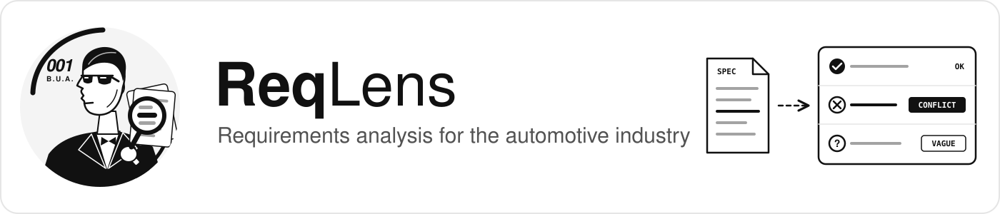
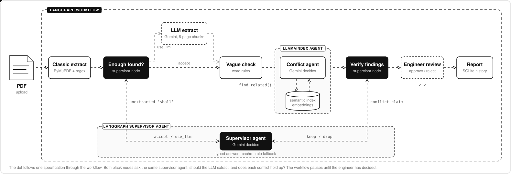

<p align="center">
  
</p>

<p align="center">
  <a href="https://github.com/BUAksakal/reqlens/actions/workflows/ci.yml"></a>
  
  
  
  
</p>

<p align="center">
  <b>ReqLens reads automotive PDF specifications, extracts the requirements and finds the ones that are ambiguous or contradict each other, before they turn into expensive bugs.</b>
</p>

---

## The problem

Car makers send their suppliers specifications (*Lastenhefte*) with hundreds of requirements. Engineers still copy them out of the PDF by hand and check them by eye:

- Is a requirement **ambiguous**? *"The system shall brake **fast**."* How fast?
- Do two requirements **contradict** each other? One section says the warning must appear within **10 s**, another says **5 s**.

These problems are usually written by different teams, end up 40 pages apart and are found months later, during testing. ReqLens finds them in minutes and lets the engineer decide.

## How it works

<p align="center">
  
</p>

| Step | What happens | Why this way |
|---|---|---|
| **Classic extraction** | PyMuPDF reads the text page by page, a regex finds IDs like `AEB-001` | Free, fast and deterministic. Tried first |
| **Supervisor: extraction** | Looks for *shall* sentences the regex missed. If there are any, Gemini decides: accept or switch to the LLM | The workflow chooses its own path per document |
| **LLM extraction** | Gemini reads the PDF in **8-page chunks** (1-page overlap) and returns typed `Requirement` objects. IDs are normalised, each chunk is cached | One call for a long document stopped halfway. Chunks keep it complete |
| **Ambiguity check** | Flags words such as *fast*, *about*, *sufficient* | Cheap baseline, no LLM |
| **Conflict check** | A **LlamaIndex agent** looks up related requirements through a semantic index (RAG) and decides whether they contradict | The agent writes its own search query for every requirement |
| **Supervisor: verification** | Gemini takes a second look at every conflict the agent reported and drops false alarms | Fewer wrong findings for the engineer |
| **Engineer review** | The workflow **pauses** (LangGraph `interrupt` + checkpointer) and resumes after the engineer's answer | LLMs can be confidently wrong. A human makes the final call |

## Results

### Extraction on a real document

[AUTOSAR SWS StandardTypes](https://autosar.org/fileadmin/standards/R24-11/CP/AUTOSAR_CP_SWS_StandardTypes.pdf), 29 pages, IDs like `[SWS_Std_00011]`:

| Method | Requirements found |
|---|:---:|
| Classic (PyMuPDF + regex) | **0** ❌ |
| LLM (Gemini via LlamaIndex) | **24** ✅ |

The document defines 22 requirements with an *Upstream requirements* line, and the LLM found all of them, plus 2 that are written in a different format. The regex only knows the format it was written for.

### Analysis on the example specification

[`examples/aeb_lastenheft.pdf`](examples/aeb_lastenheft.pdf): 18 requirements for an emergency braking system, with errors seeded on purpose and an [answer key](eval/ground_truth.jsonl).

| Seeded problem | Found |
|---|:---:|
| Conflicts (`AEB-001 ↔ AEB-002`, `AEB-014 ↔ AEB-018`) | **2 / 2** ✅ |
| Ambiguous wording | **1 / 3** ⚠️ |
| Untestable requirement | not checked yet |

## Quick start

```bash
git clone https://github.com/BUAksakal/reqlens.git
cd reqlens
uv sync
echo "GEMINI_API_KEY=your-key" > .env   # free key: https://aistudio.google.com/apikey
```

```bash
uv run reqlens parse examples/aeb_lastenheft.pdf          # classic extraction
uv run reqlens parse path/to/spec.pdf --ai                # LLM extraction
uv run reqlens analyze examples/aeb_lastenheft.pdf        # full workflow with review
uv run reqlens history                                    # past runs and approval rate
uv run streamlit run app.py                               # web interface
```

<details>
<summary><b>Example session</b></summary>

```text
$ uv run reqlens analyze examples/aeb_lastenheft.pdf

AEB-003: vague words ['fast']
Real problem? [y/N]: y

AEB-018: AEB-014: Both requirements specify different maximum time limits
(5 s vs 10 s) for displaying the same failure warning signal.
Real problem? [y/N]: y

18 requirements found.
AEB-003: vague words ['fast']
AEB-018: AEB-014: Both requirements specify different maximum time limits ...
2 findings approved by the engineer.
```

</details>

## Tech stack

| Area | Tools |
|---|---|
| PDF reading | PyMuPDF |
| LLM and embeddings | Gemini (`gemini-3.1-flash-lite`, `gemini-embedding-001`) |
| Document agent and RAG | LlamaIndex (`FunctionAgent`, `VectorStoreIndex`, structured output) |
| Orchestration | LangGraph (conditional edges, `interrupt`, checkpointer) |
| Data models | pydantic |
| CLI | typer |
| Engineering | uv, pytest, ruff, pre-commit, GitHub Actions, branch → PR workflow |

<details>
<summary><b>Project structure</b></summary>

```text
src/reqlens/
├── models.py             # Requirement model (pydantic)
├── pdf_reader.py         # PyMuPDF reading + classic regex extraction
├── ai_parser.py          # LLM extraction with structured output
├── llm.py                # Gemini LLM, embeddings, retry on 429/503
├── ambiguity.py          # vague word check
├── requirement_index.py  # semantic index over requirements
├── analysis_agent.py     # LlamaIndex conflict agent
├── workflow.py           # LangGraph workflow with engineer review
└── cli.py                # reqlens parse / analyze
scripts/build_examples.py # renders the example spec PDF and answer keys from YAML
examples/                 # example specification (YAML source + PDF)
eval/                     # answer keys
```

</details>

## Limitations

Being honest about what does not work yet:

- **Ambiguity** uses a word list and misses phrases like *"clearly perceptible"* or *"as far as possible"*.
- **Tables** are flattened by PyMuPDF, so requirements defined in tables come out as messy text.
- **LLM answers vary** between runs, and the conflict agent occasionally reports a plausible but wrong conflict. That is why the engineer review exists.
- **Free Gemini tier** is limited (few requests per day, frequent `503`). ReqLens retries automatically, but a full analysis can take minutes.
- The analysis has so far been measured on the example specification only. Evaluation on real AEB documents is next.

## Roadmap

- [x] Classic and LLM extraction
- [x] LlamaIndex conflict agent with semantic search
- [x] LangGraph workflow with engineer review
- [ ] Analysis on real documents (UN R152, Euro NCAP)
- [ ] Local model via Ollama: confidential specs never leave the machine
- [ ] SQL storage of runs and review decisions (measured precision)
- [ ] Streamlit web interface
- [ ] Docker and a live demo on AWS

---

<sub>The example specification and the company *Musterwerk Automotive GmbH* are fictional and were written for testing. AUTOSAR documents are not included in this repository.</sub>
