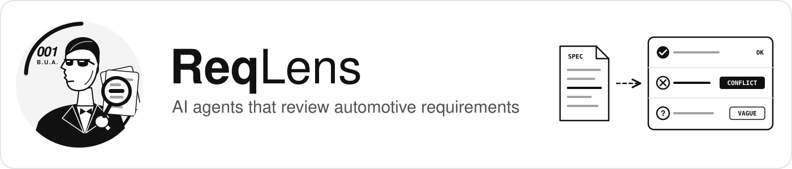
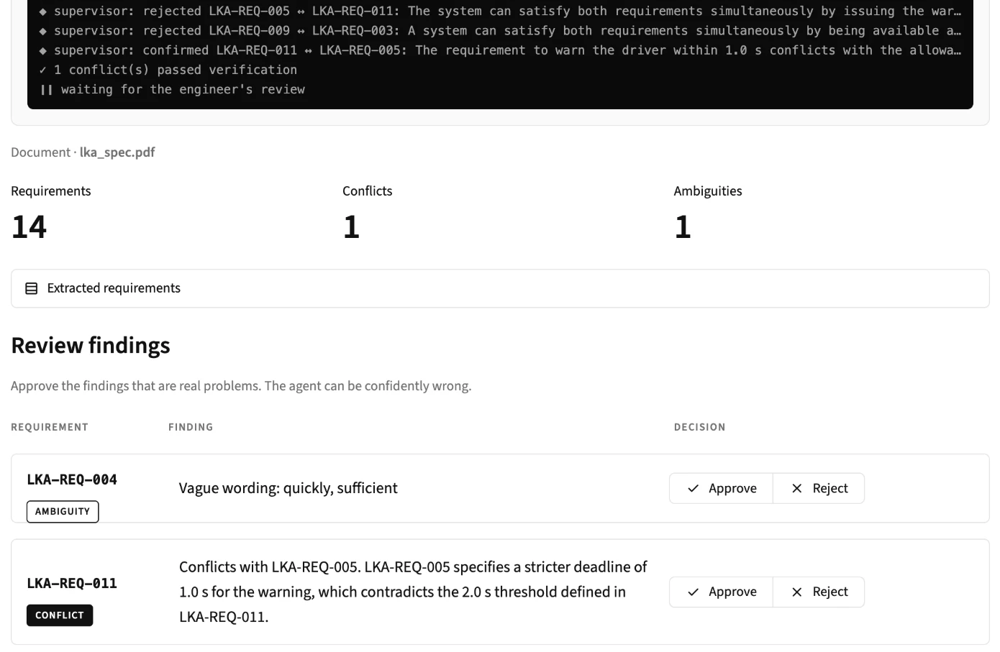

<p align="center">
  
</p>

<p align="center">
  <a href="https://guhlixj93lndfluucdkk35.streamlit.app/"></a>
  <a href="https://github.com/BUAksakal/reqlens/actions/workflows/ci.yml"></a>
  
  
  
  
  
</p>

<p align="center">
  <b>ReqLens reads automotive PDF specifications, extracts the requirements and finds the ones that are ambiguous or contradict each other, before they turn into expensive bugs.</b>
</p>

<p align="center">
  <a href="https://guhlixj93lndfluucdkk35.streamlit.app/"><b>▶ Try the live demo</b></a> · upload any text-based specification PDF (max. 60 pages)
</p>

---

## What ReqLens is

ReqLens is an **end-to-end requirements review tool built around AI agents**. You upload a specification, and ReqLens:

1. **finds every requirement** in it, whatever ID format the document uses,
2. **flags vague wording** that cannot be tested (*"fast"*, *"sufficient"*),
3. lets an **AI agent search the document for contradicting requirements**,
4. lets a **supervisor agent double-check** every contradiction the first agent reports,
5. **pauses for the engineer**, who approves or rejects each finding,
6. **stores the decision**, so you can see how often the AI was right.

The AI proposes, the engineer decides. Both supervisor decisions fall back to a simple rule when no model answers, and every LLM answer is cached, so a second run of the same document costs nothing.

<p align="center">
  
  <br>
  <sub>The review screen after analysing a 3-page Lane Keeping Assist specification. The supervisor confirmed one conflict and rejected two, and the engineer has the final say.</sub>
</p>

## The problem

Car makers send their suppliers specifications (*Lastenhefte*) with hundreds of requirements. Engineers still copy them out of the PDF by hand and check them by eye:

- Is a requirement **ambiguous**? *"The system shall brake **fast**."* How fast?
- Do two requirements **contradict** each other? One section says the warning must appear within **10 s**, another says **5 s**.

These problems are usually written by different teams, end up 40 pages apart and are found months later, during testing. ReqLens finds them in minutes and lets the engineer decide.

## How it works

<p align="center">
  
</p>

The whole flow is a **LangGraph** graph. Two agents work inside it:

- a **LlamaIndex conflict agent** that searches the document on its own, and
- a **supervisor agent** that makes the routing and verification decisions.

| Step | What happens | Why this way |
|---|---|---|
| **Classic extraction** | PyMuPDF reads the text page by page, a regex finds IDs like `AEB-001` | Free, fast and deterministic. Tried first |
| **Supervisor: extraction** | Looks for *shall* sentences the regex missed. If there are any, Gemini decides: accept or switch to the LLM | The workflow chooses its own path per document |
| **LLM extraction** | Gemini reads the PDF in **8-page chunks** (1-page overlap) and returns typed `Requirement` objects. IDs are normalised, each chunk is cached | One call for a long document stopped halfway. Chunks keep it complete |
| **Ambiguity check** | Flags words such as *fast*, *about*, *sufficient* | Cheap baseline, no LLM |
| **Conflict check** | A **LlamaIndex agent** looks up related requirements through a semantic index (RAG) and decides whether they contradict. At most 12 checks per document, the most similar requirements first | The agent writes its own search query for every requirement |
| **Supervisor: verification** | Gemini takes a second look at every conflict the agent reported and drops false alarms | Fewer wrong findings for the engineer |
| **Engineer review** | The workflow **pauses** (LangGraph `interrupt` + checkpointer) and resumes after the engineer's answer | LLMs can be confidently wrong. A human makes the final call |
| **Report** | Findings and decisions go into SQLite. The approval rate is the measured precision | Shows how often the AI was right |

**Guardrails.** Supervisor answers are typed (`accept` / `use_llm`, `confirmed: bool`), so the LLM cannot invent a new path. Every answer is cached per document, so a second run costs no quota. When all five Gemini models are busy, the supervisor falls back to a rule and keeps every conflict for the engineer instead of dropping it. Documents over 60 pages are refused before any LLM call.

## Results

### Extraction on real documents

| Document | Pages | Classic (regex) | LLM (Gemini) |
|---|:---:|:---:|:---:|
| [UN Regulation No. 152](https://eur-lex.europa.eu/legal-content/EN/TXT/?uri=OJ:L_202402497) (AEBS for M1/N1 vehicles) | 38 | **0** ❌ | **144** ✅ |
| [AUTOSAR SWS StandardTypes](https://autosar.org/fileadmin/standards/R24-11/CP/AUTOSAR_CP_SWS_StandardTypes.pdf) | 29 | **0** ❌ | **24** ✅ |

- **UN R152:** 97 of 99 numbered *shall* paragraphs in the main body were found. The two missing ones are section headings. Annex requirements keep their annex (`Annex 3 3.1`), so they do not collide with the main body. No IDs were invented.
- **AUTOSAR:** all 22 requirements with an *Upstream requirements* line, plus 2 written in a different format.

The regex only knows the format it was written for. The supervisor notices this and hands the document to the LLM.

### Analysis on the example specification

[`examples/aeb_lastenheft.pdf`](examples/aeb_lastenheft.pdf): 18 requirements for an emergency braking system, with errors seeded on purpose and an [answer key](eval/ground_truth.jsonl).

| Seeded problem | Found |
|---|:---:|
| Conflicts (`AEB-001 ↔ AEB-002`, `AEB-014 ↔ AEB-018`) | **2 / 2** ✅ |
| Ambiguous wording | **1 / 3** ⚠️ |
| Untestable requirement | not checked yet |

## Quick start

### Live demo

Open **[the live demo](https://guhlixj93lndfluucdkk35.streamlit.app/)**, upload a specification PDF and click **Analyze**. The demo runs on the free Gemini tier, so it may answer slowly or ask you to try again later.

### Local

```bash
git clone https://github.com/BUAksakal/reqlens.git
cd reqlens
uv sync
echo "GEMINI_API_KEY=your-key" > .env   # free key: https://aistudio.google.com/apikey
```

```bash
uv run streamlit run app.py                               # web interface
uv run reqlens parse examples/aeb_lastenheft.pdf          # classic extraction
uv run reqlens parse path/to/spec.pdf --ai                # LLM extraction
uv run reqlens analyze examples/aeb_lastenheft.pdf        # full workflow with review
uv run reqlens history                                    # past runs and approval rate
```

### Docker

```bash
docker build -t reqlens .
docker run --rm -p 8501:8501 --env-file .env reqlens      # open http://localhost:8501
```

The image runs as a non-root user and contains no secrets: `.env`, the database and all PDFs are excluded by `.dockerignore`, and the API key is only passed at run time.

<details>
<summary><b>Example CLI session</b></summary>

```text
$ uv run reqlens analyze examples/aeb_lastenheft.pdf

AEB-003: vague words ['fast']
Real problem? [y/N]: y

AEB-018: AEB-014: Both requirements specify different maximum time limits
(5 s vs 10 s) for displaying the same failure warning signal.
Real problem? [y/N]: y

18 requirements found.
AEB-003: vague words ['fast']
AEB-018: AEB-014: Both requirements specify different maximum time limits ...
2 findings approved by the engineer.
Saved as run #1 in reqlens.db
```

</details>

## Deployment

| | |
|---|---|
| **Live demo** | Streamlit Community Cloud, deployed from `main`. Every merged pull request updates the demo |
| **Secrets** | The Gemini key lives in the platform's secret store, never in the code or the repository |
| **Container** | The same app ships as a Docker image, ready for any container host (AWS, Azure, on-premise) |
| **CI** | GitHub Actions runs ruff and pytest on every pull request |

## Tech stack

| Area | Tools |
|---|---|
| PDF reading | PyMuPDF |
| LLM and embeddings | Gemini (five models with automatic fallback, `gemini-embedding-001`) |
| Agents and orchestration | LangGraph (supervisor agent, conditional edges, `interrupt`, checkpointer, streaming) |
| Document agent and RAG | LlamaIndex (`FunctionAgent`, `VectorStoreIndex`, structured output) |
| Storage | SQLite (runs, review decisions, LLM answer cache) |
| Interface | Streamlit (web), typer (CLI) |
| Data models | pydantic |
| Deployment | Docker, Streamlit Community Cloud |
| Engineering | uv, pytest, ruff, pre-commit, GitHub Actions, branch → PR workflow |

<details>
<summary><b>Project structure</b></summary>

```text
app.py                    # Streamlit web interface with live workflow view
src/reqlens/
├── models.py             # Requirement model (pydantic)
├── pdf_reader.py         # PyMuPDF reading + classic regex extraction
├── ai_parser.py          # chunked LLM extraction with structured output
├── llm.py                # Gemini models, embeddings, fallback on 429/503
├── ambiguity.py          # vague word check
├── requirement_index.py  # semantic index over requirements
├── analysis_agent.py     # LlamaIndex conflict agent
├── supervisor.py         # supervisor agent: extraction decision, conflict verification
├── workflow.py           # LangGraph workflow with engineer review
├── cache.py              # LLM answer cache
├── storage.py            # SQLite runs and review decisions
└── cli.py                # reqlens parse / analyze / history
tests/                    # pytest, no API key needed
scripts/build_examples.py # renders the example spec PDF and answer keys from YAML
examples/                 # example specification (YAML source + PDF)
eval/                     # answer keys
Dockerfile                # container image for the web interface
```

</details>

## Limitations

Being honest about what does not work yet:

- **Ambiguity** uses a word list and misses phrases like *"as smooth as possible"* or *"appropriately"*.
- **LLM answers vary** between runs. The supervisor can be too lenient: it sometimes rejects a real conflict, for example two different minimum speeds for the same function. That is why the engineer review exists.
- **The same pair can be checked twice** (`A ↔ B` and `B ↔ A`) and get two different verdicts.
- **Free Gemini tier** is limited (few requests per day, frequent `503`). ReqLens switches between five models and caches every answer, but a full analysis can take minutes.
- **Document size:** the LLM reads at most **60 pages** per document (9 requests) and uploads are capped at **20 MB**, so one file cannot use up the daily quota. Longer specifications have to be split.
- **Demo history** is stored inside the running app and resets when the demo restarts.
- The conflict analysis has been measured on the example specification only.

## Roadmap

- [x] Classic and LLM extraction
- [x] LlamaIndex conflict agent with semantic search
- [x] LangGraph workflow with engineer review
- [x] SQL storage of runs and review decisions (measured precision)
- [x] Streamlit web interface
- [x] Supervisor agent with guardrails
- [x] Analysis on a real regulation (UN R152)
- [x] Docker image and live demo
- [ ] Check each requirement pair only once
- [ ] LLM-based ambiguity check
- [ ] Deployment on AWS

---

<sub>The example specification and the company *Musterwerk Automotive GmbH* are fictional and were written for testing. AUTOSAR and UN documents are not included in this repository.</sub>
